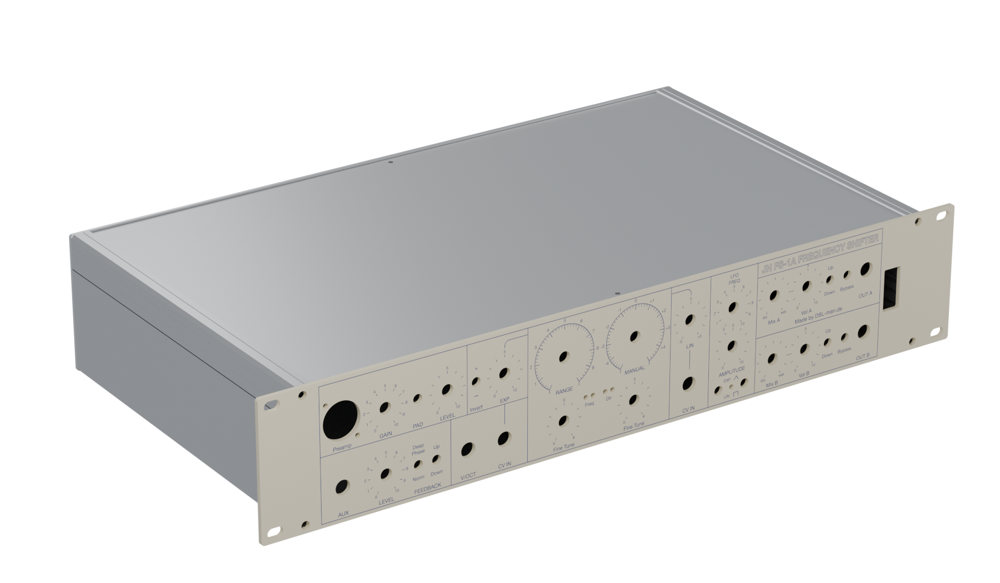
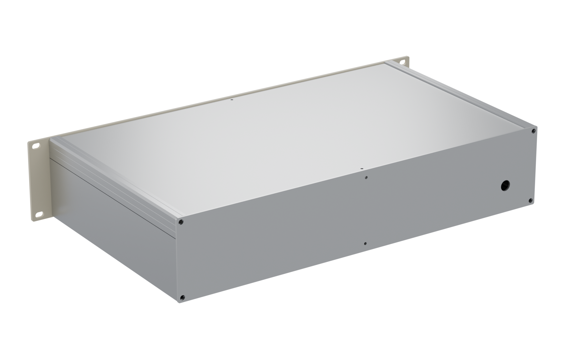
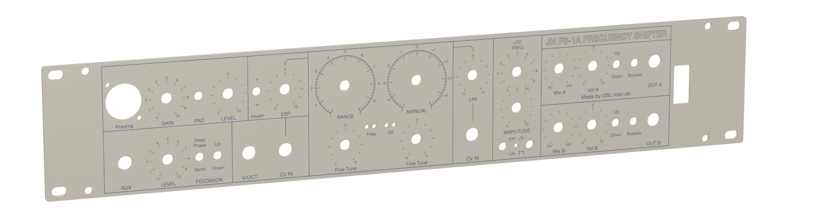
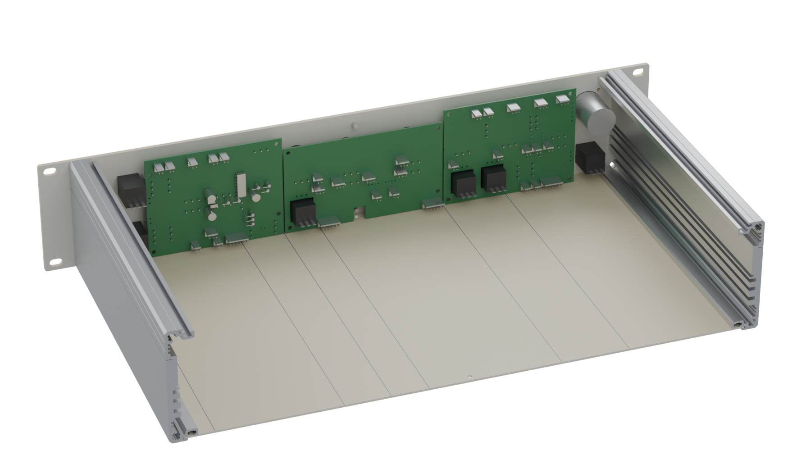
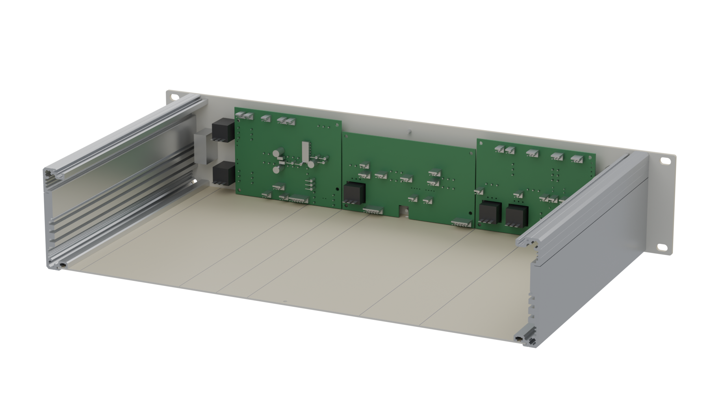

# JH FS-1A Frequency Shifter — 19" / 2 U enclosure, 3D views

Mechanical design for a rack build of Jürgen Haible's **FS-1A frequency shifter**:
front panel, rear panel, side rails, top and bottom covers, plus the three control
panel PCBs that sit behind the panel. Enclosure **Rev0.1**, control PCBs **Rev0.2**.

## Interactive viewer

**[Open the 3D viewer in your browser](https://dslmande.github.io/fs1a-case-3d/)** —
drag to rotate, wheel to zoom, shift-drag or right-drag to pan. Parts can be switched
on and off, the enclosure can be made see-through, a section can be moved from the
front to the back, and the explode slider pulls the build apart. Click a part to see
its name.

The file [`index.html`](index.html) is self-contained — geometry and the panel artwork
are embedded; only three.js comes from a CDN.

## Views

| | |
|---|---|
|  |  |
| Enclosure, front oblique | Rear: cable gland Ø 12 mm |
|  |  |
| Front panel, 482.6 × 88.1 × 3 mm | Control PCBs behind the panel |
|  | |
| Control PCBs from the side | |

The front panel carries the real print artwork, not a mock-up: the texture is the
same vector file that goes to the panel shop.

## Where the geometry comes from

Nothing here is modelled by hand. The enclosure comes from the STEP assembly that the
generator scripts in **[dslmande/Casedesigns](https://github.com/dslmande/Casedesigns)**
produce (folder `FS-1A-Frequency-Shifter`), which is also where the manufacturing files
live — Schaeffer `.fpd`, DXF, drill schedules and the print-ready PDF, CC BY-SA 4.0.

The control panel PCBs are a separate design and **available on request from
[diysynth.de](https://diysynth.de)**; their design files are not published.

## Dimensions

| | |
|---|---|
| Front panel | 482.6 × 88.1 × 3 mm, corners R2 |
| Enclosure body | 437 mm wide, 250 mm deep (Gie-Tec side rail profile 4) |
| Rear panel | 437 × 88.1 × 2 mm, Ø 12 mm cable hole |
| Top / bottom cover | 416 × 249.5 × 1.5 mm aluminium sheet |
| Control PCBs | 107.5 × 81, 126 × 71.2 and 105 × 81 mm, 2 layers |

## License

© 2026 Dsl-man.de — enclosure design and viewer under
[CC BY-SA 4.0](https://creativecommons.org/licenses/by-sa/4.0/).
Circuit design: Jürgen Haible. This repository holds mechanical data only.
